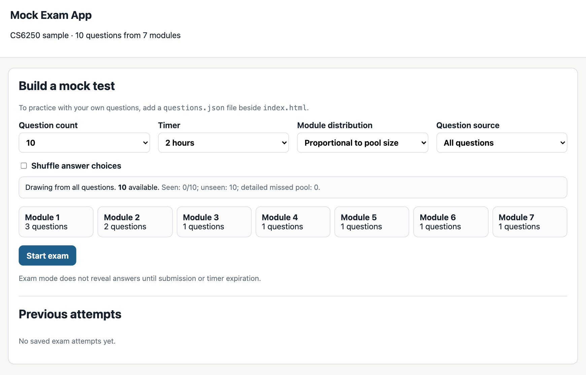
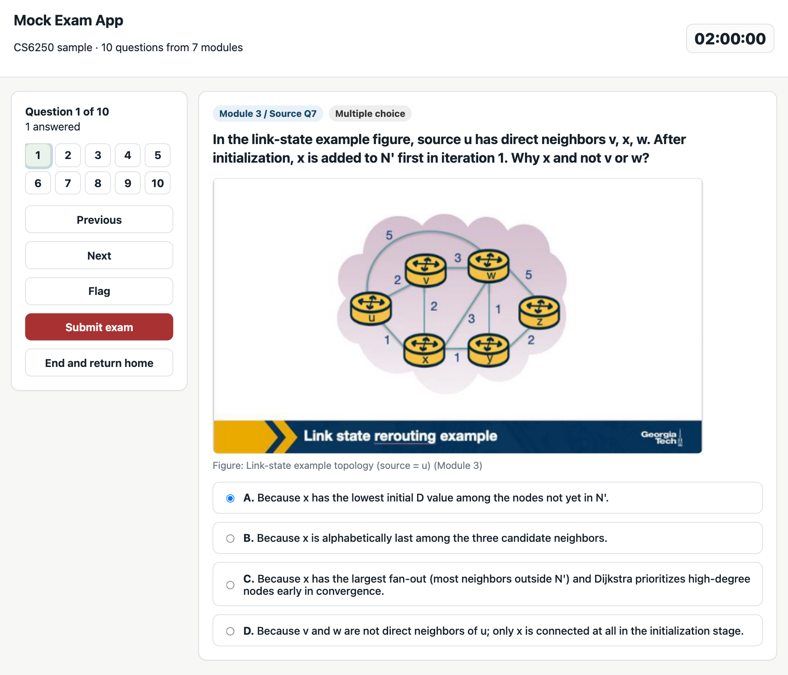

# Mock Exam App

A browser-based practice exam builder. It samples questions from a JSON bank, runs timed or untimed exams, and shows scores and answer explanations after submission. Progress and attempt history stay in the browser. This app was originally created to help prepare for exams in Georgia Tech's CS6250 but has since been adapted to other courses. It allows for multiple choice with one or more correct answers and true/false question types.

## Screenshots

### Exam setup



### In-progress exam



## Features

- **Exam length and timing.** Choose 10 to 60 questions in increments of 10, depending on the bank size, or let the app pick a random length from 40 to 60. Set a 30-, 60-, 90-, or 120-minute timer, or take the exam untimed. Timed exams submit automatically when time runs out.
- **Module distribution.** Assign each question to a module. The app can sample in proportion to the size of each module's question pool or spread questions as evenly as possible across modules.
- **Optional question images.** Use the `images` field to attach one or more diagrams, screenshots, or figures. Images appear during the exam and in answer review. Set `figureCaption` to display a caption during the exam.
- **Answer review.** See explanations after submission and reopen question review from **Previous attempts**. Questions with a source PDF link open the referenced page in a new tab.
- **Partial credit.** On select-all questions, each correct option earns an equal share of the point. Choosing two of three correct options earns two-thirds credit. Selecting any incorrect option earns zero for that question.
- **Attempt history.** Compare scores and elapsed times in **Previous attempts**. Build a follow-up exam from all questions, only unseen questions, or only questions you previously missed.
- **Module performance.** See points earned and percentage scores for each module after an exam. Across saved attempts, review each module's cumulative score, how many unique questions you've seen, and which questions you've missed.

## Run locally

With Python 3 installed, start a server from the repository root.

```sh
python3 -m http.server 8000
```

Open [http://localhost:8000](http://localhost:8000) and select **Start exam**. A fresh clone loads the bundled [CS6250 sample bank](questions.sample.json), which has 10 questions covering all three question types and includes five illustrated questions.

## Use your own question bank

Copy `questions.sample.json` to `questions.json` beside `index.html`, replace the sample questions with your own, and reload the app. The app uses a nonempty `questions.json` in preference to the demo. Keep any image files at the paths specified in your bank, and put PDFs referenced by your questions in `sources/`. Git ignores the personal bank and its source PDFs.

Demo attempts and in-progress exams have their own browser history. To keep multiple personal banks on the same site, set a different stable `meta.bankId` for each new bank. For an existing bank with saved attempts, retain its current `bankId` or leave it unset if it already uses the default history.

## Question bank format

- `meta.questionCount` is the total number of questions. `meta.moduleCounts` maps each module name to its question count. Keep both in sync with `questions`.
- Each question has a unique string `id`, a `module` matching a key in `moduleCounts`, a question `number` within that module, and a `prompt`.
- Set `type` to `multiple_choice`, `true_false`, or `select_all`. The `choices` object maps each choice key to its display text. Set `correctAnswer` to the matching key, or use comma-separated keys such as `"A, C"` for `select_all`.
- Optional fields include `explanation`, `images` (an array of image paths relative to `index.html`), and `figureCaption`. Use `\n\n` between paragraphs in an explanation.
- To link a review source, set `sourcePdf` to the exact PDF filename in `sources/` and `sourcePage` to its 1-based physical page number. The bundled demo includes its figures and explanations.

This one-question example follows the OMSCS CS6250 bank format and uses an original practice question. Add at least 10 questions to use the standard exam lengths.

```json
{
  "meta": {
    "questionCount": 1,
    "moduleCounts": { "Module 1": 1 }
  },
  "questions": [
    {
      "id": "m01-q001",
      "module": "Module 1",
      "number": 1,
      "type": "multiple_choice",
      "prompt": "Which device forwards packets between IP networks?",
      "choices": { "A": "Router", "B": "Repeater", "C": "Hub" },
      "correctAnswer": "A",
      "explanation": "A router uses destination IP addresses to forward packets between networks."
    }
  ]
}
```
